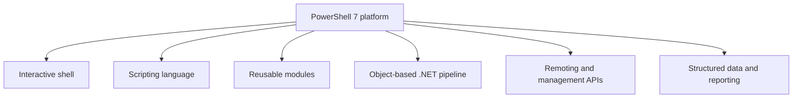
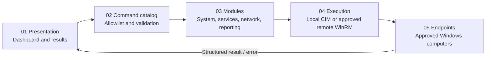
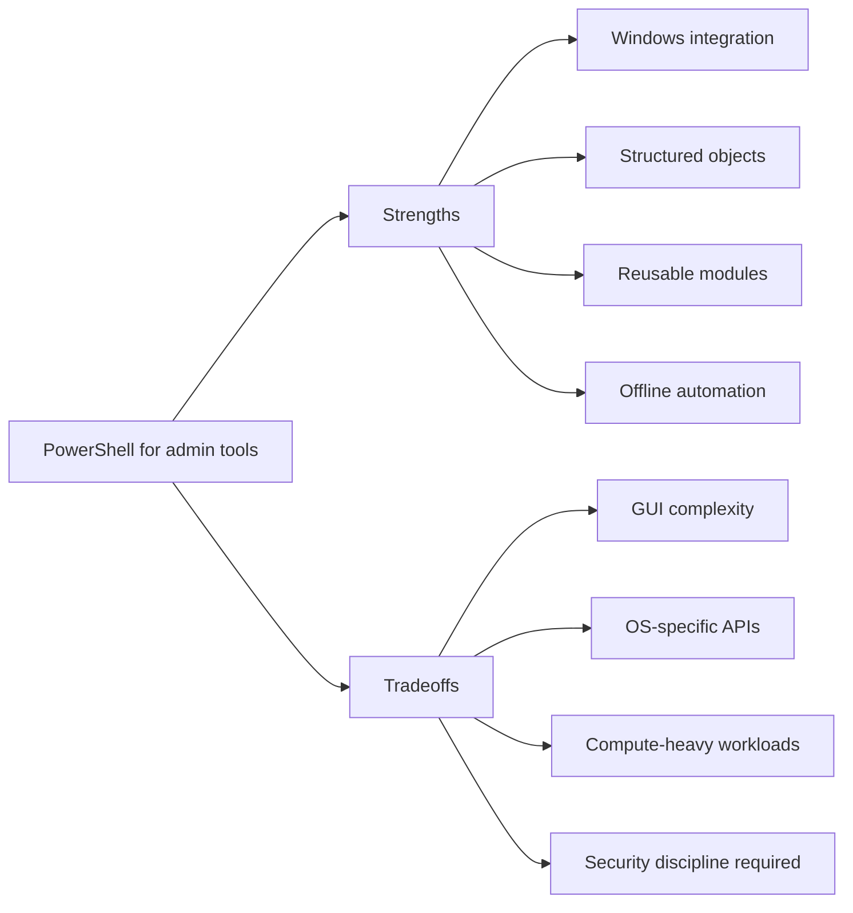
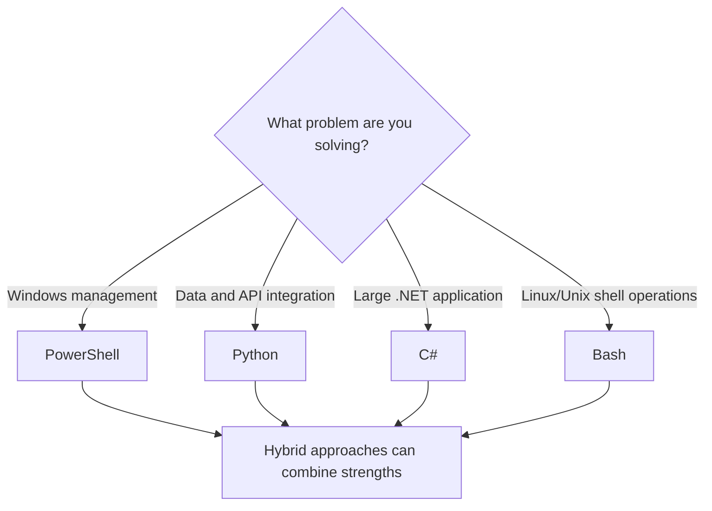
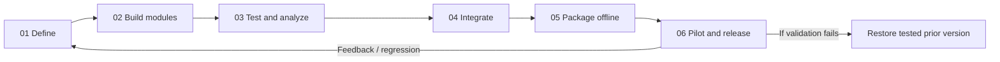

# PowerShell Beyond the Script: Building Modular Administration Tools That Last

*Why PowerShell is a compelling administration platform, where its limits matter, and how modular design improves maintainability.*

**Mark Hunsaker · Independent technical article · October 2026**

> What happens when your PowerShell scripts become a toolbox nobody wants to touch?

It usually starts simply: automate a repetitive task, collect information from multiple computers, make troubleshooting faster. For many system administrators, PowerShell is the natural starting point. But as the script count grows, so does the question: **how do you build a dashboard that stays maintainable as its command count increases?**

That question motivated a modular PowerShell-based System Administrator Dashboard prototype. Working through that design reinforced a simple principle: **the language matters, but the architecture matters just as much.**

## PowerShell as a platform

PowerShell is more than a command prompt. Originally developed by Microsoft for Windows administration, it is now an open-source, cross-platform automation shell and scripting language. PowerShell 7 runs on Windows, Linux, and macOS, although some modules and graphical technologies remain operating-system specific.

It combines an interactive shell, a language for functions and reusable modules, and an automation environment that integrates with system tools and APIs. Its key differentiator is the **object-based pipeline**: commands generally pass structured .NET objects rather than unstructured text.

A service query, for example, exposes typed properties such as state and startup mode. Administrators can filter and format those properties without fragile string parsing. Common integration formats include CSV, JSON, XML, and REST APIs.



*Figure 1. PowerShell combines shell, language, modules, object pipelines, remoting, and data integration. PowerShell is cross-platform; not all administrative modules or UI frameworks are.*

## Why a modular approach?

Small scripts tend to grow. Before long, one file handles command selection, user interaction, connectivity, data collection, reporting, and error handling. A minor change can unexpectedly break unrelated capabilities.

A modular dashboard separates responsibilities:

1. **Presentation:** displays available operations and results.
2. **Command catalog:** exposes an explicit allowlist.
3. **Modules:** perform specific administrative tasks.
4. **Execution layer:** controls local or approved remote queries.

Instead of embedding logic in the interface, a function such as `Get-SystemInventory` can be written, reviewed, and tested independently, then reused from a console, a scheduled report, or the dashboard without duplicating logic. A minimal Windows example looks like this:

```powershell
function Get-SystemInventory {
    [CmdletBinding()]
    param([Parameter(Mandatory)]
          [ValidateNotNullOrEmpty()][string]$ComputerName)

    $cim = @{ ComputerName = $ComputerName; ErrorAction = 'Stop' }
    $os  = Get-CimInstance -ClassName Win32_OperatingSystem @cim
    $cs  = Get-CimInstance -ClassName Win32_ComputerSystem @cim

    [pscustomobject]@{
        ComputerName = $ComputerName
        OS           = $os.Caption
        LastBoot     = $os.LastBootUpTime
        MemoryGB     = [math]::Round($cs.TotalPhysicalMemory / 1GB, 1)
    }
}
```

Validated input, a stable output type, explicit error behavior, and no UI code: that is the contract a module boundary should enforce. This illustrative function uses Windows-only CIM capabilities and requires appropriate network access and authorization for remote targets.



*Figure 2. Modular System Administrator Dashboard reference architecture. Design boundaries: read-only by default, explicit target selection, no cloud runtime dependency, and versioned modules.*

### Benefits of separation

A well-defined module boundary simplifies maintenance and fault isolation, promotes reuse, reduces accidental coupling, supports regression testing, and allows components to be versioned and rolled back. Modules are not magic: stable parameter contracts, predictable output types, dependency checks, and change discipline are still required.

## The advantages of PowerShell

**Native Windows administration.** PowerShell integrates naturally with Windows services, event logs, Active Directory tooling, CIM/WMI, and a broad range of Microsoft administration interfaces.

**An accessible growth path.** Administrators who work interactively with cmdlets can gradually introduce functions, parameter validation, structured error handling, tests, and modules without switching languages.

**Structured automation and reporting.** Run a consistent check, retrieve structured data, classify results, format a report, and preserve an audit trail.

**Modularity and controlled deployment.** Functions and modules can be packaged with local documentation and dependencies. In restricted environments, approved self-contained artifacts can run offline without a live connection to a package registry or source-hosting service.

## Limitations that deserve equal attention

**Desktop GUI engineering is more complex than scripting.** Windows Forms and WPF are Windows-specific. Long-running network operations can freeze an interface unless you manage background work, cancellation, timeouts, and event handling. For a cross-platform UI, a web front end or a console-based interface may be preferable.

**Cross-platform does not mean feature parity.** PowerShell 7 is cross-platform, but Windows administration modules, Windows CIM/WinRM behavior, and specific management APIs may not be. Validate portability feature by feature.

**Performance and application scale.** For compute-intensive workloads or large applications, compiled C# components or a dedicated application framework can be a better fit. PowerShell remains valuable as an orchestrator when the heavy lifting is delegated.

**Security is an engineering obligation.** Input validation, least privilege, authorization, logging, safe defaults, and reviewable commands matter. Execution policy is a defense-in-depth safety mechanism, **not a security boundary**. A graphical wrapper must not become a conduit for arbitrary remote commands. Where appropriate, Just Enough Administration (JEA) and enforced application-control policies provide stronger restrictions; script signing supports provenance and some policy decisions, but does not by itself authorize an operation.



*Figure 3. Technical advantages and limitations should be evaluated together.*

## How does PowerShell compare with other languages?

There is no universal winner. PowerShell excels at Windows administration and orchestration. Python has a broad ecosystem for data processing, integrations, and cross-platform applications. C# suits strongly typed .NET applications and demanding desktop software. Bash remains natural for Linux and Unix command-line workflows.

| Platform | Best fit | Principal strength | Tradeoff |
|---|---|---|---|
| **PowerShell** | Windows administration and orchestration | Native administration cmdlets, structured objects, CIM, modules | Windows-specific GUI/API boundaries |
| **Python** | Data processing, APIs, cross-platform workflows | Broad ecosystem and libraries | OS administration often needs extra packages |
| **C#** | Desktop software, services, large applications | Static typing, .NET tooling, performance | Greater application and build overhead |
| **Bash** | Linux/Unix automation and native utilities | Portable shell patterns and simple system scripting | Text parsing and complex program structure |



*Figure 4. Fit-for-purpose comparison for common systems administration use cases.*

A hybrid solution may be the most maintainable. PowerShell can provide command routing and Windows management functions, while Python or C# handles specialized processing and Bash handles Linux-native maintenance.

## What belongs in a reliable administrator dashboard?

I favor a few operational principles over features for their own sake:

1. **Read-only by default.** Discovery and diagnostics should not change anything.
2. **Explicit targets.** The operator selects each permitted target; no accidental broad network discovery.
3. **Clear contracts.** Registered commands have defined inputs, outputs, and error behavior.
4. **Disciplined releases.** Artifacts carry version identification, dependency checks, test evidence, and a rollback path.

Testing is part of that discipline: Pester for unit and smoke tests, and PSScriptAnalyzer for static analysis, run before anything is packaged.

> A dashboard should simplify administration without concealing what it does.

The operator must still understand the command, its target, required privileges, and the limits of its results.



*Figure 5. A disciplined modular workflow supports independent development, offline releases, and recovery. Release gate: approved source, no private configuration, test evidence, checksums, and tested rollback.*

## Final perspective

PowerShell is not the best choice for every application. For Windows-oriented administration, network diagnostics, remote system queries, and operational reporting, it offers a practical combination of mature tooling and accessible development. The important decision is to keep boundaries clear so individual modules can evolve as requirements change.

Effective automation is not measured by line count or dashboard buttons. It is measured by reliability, maintainability, and the useful work it enables administrators to perform.

**Are you using PowerShell mostly for individual scripts, or have you started building modular administration applications around it? What architectural decisions have paid off in your environment?**

## Technical references

- [PowerShell overview](https://learn.microsoft.com/en-us/powershell/scripting/overview?view=powershell-7.5) — Microsoft Learn
- [About PowerShell modules](https://learn.microsoft.com/en-us/powershell/module/microsoft.powershell.core/about/about_modules?view=powershell-7.5) — Microsoft Learn
- [PowerShell remoting requirements](https://learn.microsoft.com/en-us/powershell/module/microsoft.powershell.core/about/about_remote_requirements?view=powershell-7.5) — Microsoft Learn
- [About execution policies](https://learn.microsoft.com/en-us/powershell/module/microsoft.powershell.core/about/about_execution_policies?view=powershell-7.5) — Microsoft Learn
- [Get-CimInstance](https://learn.microsoft.com/en-us/powershell/module/cimcmdlets/get-ciminstance?view=powershell-7.5) — Microsoft Learn
- [Use App Control to secure PowerShell](https://learn.microsoft.com/en-us/powershell/scripting/security/app-control/application-control?view=powershell-7.5) — Microsoft Learn

---

**Publication note:** This article describes an independent, generic reference architecture. The associated PowerShell prototype is **experimental** and should not be confused with validated production software. No internal credentials, organization-specific source code, or private infrastructure details are included.
